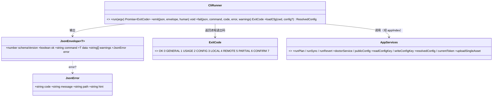
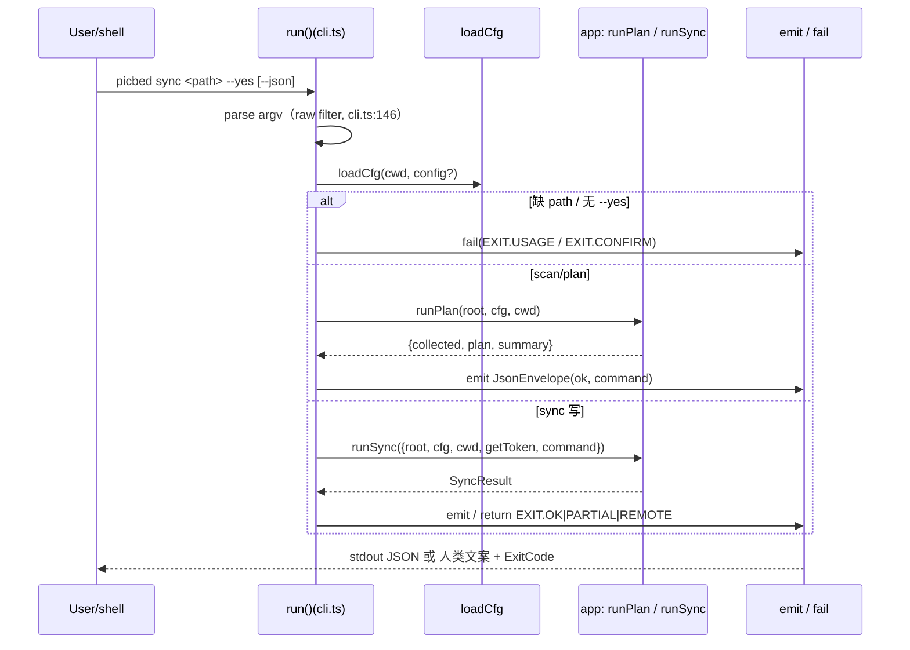

# cliops 模块详细设计

> 归属功能点：F1 项目初始化与配置、F2 环境与鉴权自检、F10 Agent 机器接口、F12 watch 监听、F14 VS Code/MCP 包装、F15 Token 鉴权。
> 架构见 [`../architecture.md`](../architecture.md)；定义见 [`../features-index.md`](../features-index.md)；全局契约见 [`cross-cutting.md`](cross-cutting.md)。

## 目的

cliops 负责 **配置生命周期、健康检查、命令编排入口与机器可读契约**，使 picbed 对人可读、对 Agent 可编程。业务规则在 ingest/transfer/rewrite；本模块保证输入合法、输出稳定、失败可判定。

边界原则：
- Token **只**从 ENV / `gh`（GitHub CLI）读取；输出一律掩码。  
- 非 TTY **禁止**交互阻塞；写文件类命令无 `--yes` 时退出码 7。  
- `--json` 时 stdout 仅 JSON，诊断走 stderr。
- **编排唯一实现在 `src/app/`**（见 [`module-app.md`](module-app.md)）：CLI 只做 argv 解析、确认门（`--yes`）、JSON 信封与退出码映射；collect/plan/sync/revert/doctor/config/runs 均调用 app 共享层，不复制业务编排。

## 模块文件夹结构（栈无关）

```
cliops/
├─ domain/
│  ├─ cqe/           # InitConfigCommand、DoctorQuery、GlobalFlags
│  ├─ entity/        # ResolvedConfig、DoctorReport、JsonEnvelope
│  ├─ service/       # ConfigLoader、OutputFormatter；编排与 DoctorService 调用 app 共享层
│  └─ facade/        # CliFacade
├─ exceptions/       # ConfigInvalidError、UsageError、AuthError
└─ cli/              # argv 解析、子命令注册、进程退出码映射
```

## 配置模型（ResolvedConfig）

```
host:   { type: github|local }
github: { owner, repo, branch, dir }
local:  { root, publicBase, dir }
url:    { style: raw|jsdelivr|custom, customTemplate? }
scan:   { extensions[], ignore[] }
upload: { concurrency, commitMessage }
rewrite:{ backup: boolean }
# token 不在 ResolvedConfig 的可序列化输出中；仅内存注入 HostAdapter
```

优先级：**CLI flags > ENV > ./picbed.toml > ./.picbed/config.toml > 用户级**。

## F1 项目初始化与配置

- `init`：写出 `picbed.toml` 模板（无 secret）；已存在需 `--force`。  
- `config get|set|list`：枚举校验（如 `url.style`）由 app 层 `writeConfigKey` 单点执行；`list` 对 secret 掩码 `****`。  
- 非法配置：退出码 2（用法）或 3（缺鉴权类），消息含键名。

## F14 VS Code / MCP 包装

- 入口：`picbed-mcp`（stdio，newline-delimited JSON-RPC 2.0）。
- Tools：`picbed_doctor|scan|plan|sync|upload|revert`——每个 tool **只**拼 CLI argv 并 `spawn` `picbed … --json`。
- **禁止**在包装层重写抽取/上传/回写规则；输出原样透传 CLI JSON。
- VS Code：把 `picbed-mcp` 配进 MCP / 任务即可；扩展层不承载业务。

## F12 watch 监听

- `watch <path> --debounce <ms>`：`fs.watch` 递归监听文档目录；防抖合并变更批次。
- 触发后调用既有 `sync` 子命令（spawn CLI，不复制业务规则）；支持 `--dry-run`。
- 可退出：SIGINT / SIGTERM 关闭 watcher 后进程结束；**无**常驻服务/特权。

## F2 环境与鉴权自检

Doctor 实现于 app 共享层 `doctorService`（[`module-app.md`](module-app.md)），**按 `host.type` 分派**：

github 主机：
1. 必需配置键存在且类型正确（owner/repo/branch）  
2. token 存在（不回显）  
3. GitHub API 可达  
4. 对 `owner/repo` 具备 Contents 读写（最小探测）  

local 主机：仅检查 `host.type`，**不**要求 token，也**不**做 API 探测。

输出 `DoctorReport { ok, checks[], failures[] }`；github 主机任一 hard 失败 → 退出码 3；local 主机无 token 亦 `ok=true`。

## F10 Agent 机器接口

- 每个子命令支持 `--json`，信封：`{ schemaVersion, ok, command, data?, error?, warnings? }`。  
- 退出码表见 [`cross-cutting.md`](cross-cutting.md)。  
- 幂等提示写入 data，供 Agent 断点续跑。  
- `picbed commands --json` 列出命令与选项（可发现性）。

## F15 GitHub Token 鉴权

### 意图

**不提供 OAuth 登录**（自建 OAuth App 对最终用户过重）。鉴权只使用现成 token。

### Token 解析顺序

1. `PICBED_GITHUB_TOKEN`
2. `GITHUB_TOKEN`
3. 本机凭据 `~/.picbed/credentials.json`（`picbed login` 写入）
4. `gh auth token`（`gh` = **GitHub CLI** 官方命令行，不是 `git`；需已 `gh auth login`。`gh` 不存在则跳过）

（实现：`src/infra/gh-cli.ts#resolveToken`，`source` 依次为 `env` / `user` / `gh`。）

缺 token 时错误 **hint 必须展开说明** PAT 与 GitHub CLI 的获取方式，避免用户不知道 `gh` 是什么。

### 失败语义

| 情况 | 退出码 |
|------|--------|
| 无任何 token | 3 |
| token 无权限 / API 失败 | 5（或 doctor 汇总 3） |
| `login` / `logout` | 2（已移除，给出 hint） |

## 实现落点（TS/Electron 适配）

> 本模块在 TypeScript/Electron 实际源码中的落地；领域意图与 F 章节见上文。签名与类图以真实源码为准（源码：`src/cli.ts`、`src/app/index.ts` barrel、`src/types.ts`）。

### 实际文件夹结构

```text
src/
├─ cli.ts          # run(argv)：参数解析 + 子命令分发 + emit/fail 输出
├─ app/
│  └─ index.ts     # barrel：再导出全部应用服务（CLI/Web 共用唯一入口）
└─ types.ts        # JsonEnvelope<T> / JsonError / EXIT / ExitCode
```

### 领域层类图（CLI 编排 + 信封契约）



### 服务签名（TS）

| 服务 | 签名 | 职责 |
|------|------|------|
| `run` | `run(argv: string[]): Promise<ExitCode>` | CLI **唯一导出**：解析 argv → 分发子命令 → 调 app 服务 → 返回退出码 |
| `emit` | `emit<T>(json: boolean, envelope: JsonEnvelope<T>, human: () => void): void` | JSON 输出信封，否则调用 `human()`；模块私有 |
| `fail` | `fail(json: boolean, command: string, code: ExitCode, error: { code: string; message: string; path?: string; hint?: string }, warnings: string[] = []): ExitCode` | 输出错误信封并返回对应 `ExitCode`；模块私有 |
| `loadCfg` | `loadCfg(cwd: string, config?: string): ResolvedConfig` | 转调 `app/settings.ts#resolvedConfig`（防腐层） |

> **分层收敛（2026-10-27 修）**：此前 `src/cli.ts` 直连 `./config.js`（导入 `CONFIG_NAME / configTemplate / getToken / loadConfig`），违反 [`module-app.md`](module-app.md) §分层不变量「CLI / WebUI 不得直接 import `config.ts`」。现全部经 app 层：`loadCfg` → `resolvedConfig`、token → `currentToken`、`init` 的 `CONFIG_NAME / configTemplate` → `app/settings.ts` 转发导出。守卫 `tests/layering.test.ts` 的「呈现层不直连 config.ts / user-token.ts」已同时覆盖 `src/cli.ts` 与 `ui/`（此前只过滤 `ui/` 前缀，`cli.ts` 在 `src/` 根因而漏网）。验证：还原直连后该守卫报红，报出 `cli.ts`；重构前后 CLI 输出逐字节一致。

子命令 → app 服务映射：`init`(文件写)、`doctor`→`doctorService`、`config`→`readConfigKey`/`writeConfigKey`/`publicConfig`、`ui`→`createUiServer`、`watch`→`startWatch`+子进程 `picbed sync`、`scan`/`plan`→`runPlan`、`sync`→`runSync`、`revert`→`runRevert`、`upload`→`uploadSingleAsset`。`emit`/`fail` 与 WebUI 的 `envelope` 共用同一 `JsonEnvelope` 形状，保证 CLI/Web 输出语义对齐。

### 复杂任务时序图（CLI sync）



> `src/cli.ts:416-530` 是 **scan / plan / sync / revert 四命令共用**的大分支；其中 `sync` 写路径为 `src/cli.ts:491-529`（`// sync (write)` 在 `:491`）。`runSync` 抛错走 `asAppError` → `fail(...)`（`src/cli.ts:502-504`）；顶层 `catch`（`src/cli.ts:572`）用 `exitCodeForCode(e.code)` 兜底。code → 退出码映射见 [`module-app.md`](module-app.md) §错误映射。

## 功能点映射

| F | 本模块章节 |
|---|------------|
| [F1](../features-index.md#f1-项目初始化与配置) | §F1 |
| [F2](../features-index.md#f2-环境与鉴权自检) | §F2 |
| [F10](../features-index.md#f10-agent-机器接口) | §F10 |
| [F12](../features-index.md#f12-watch-监听) | §F12 |
| [F14](../features-index.md#f14-vs-code--mcp-包装) | §F14 |
| [F15](../features-index.md#f15-github-token-鉴权) | §F15 |
