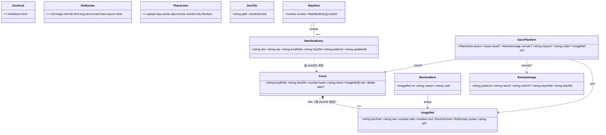
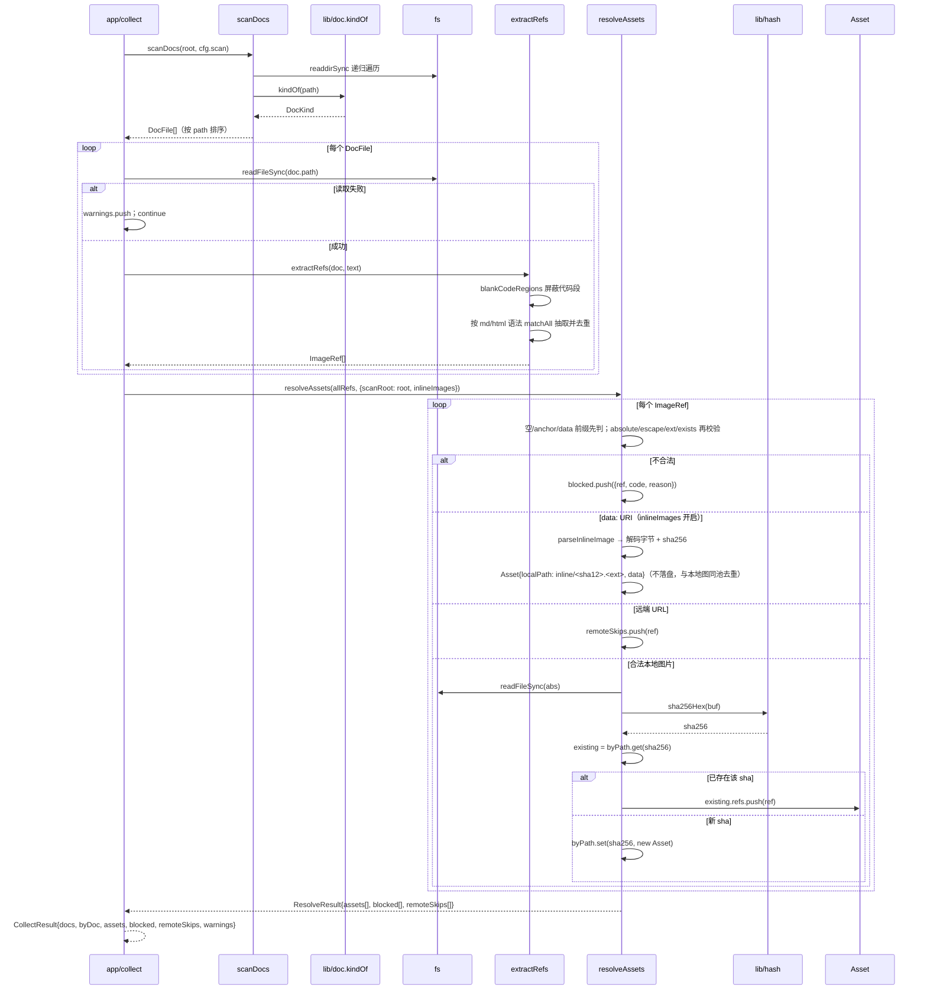

# ingest 模块详细设计

> 归属功能点：F3 目录扫描与文档发现、F4 图片引用抽取、F5 本地资产解析与去重。
> 架构总览见 [`../architecture.md`](../architecture.md)；功能定义见 [`../features-index.md`](../features-index.md)；横切见 [`cross-cutting.md`](cross-cutting.md)；上传见 [`module-transfer.md`](module-transfer.md)。
> 栈无关；接口为意图伪码。骨架：目的 / 边界 / 数据 / 接口 / 规则 / 功能点映射。

## 目的

ingest 是**文档发现与图片引用入库**限界上下文：在只读前提下扫描目录、从 Markdown/HTML 抽取图片引用、解析为本地资产并按内容哈希去重，为 transfer 提供可上传的 `Asset` 集，为 rewrite 提供精确替换锚点。

边界原则：
- **不写文档、不写图片**（回写属 rewrite；上传属 transfer）。
- **不发起网络 I/O**。
- 对外经 `IngestFacade`：`scanDocs` / `extractRefs` / `resolveAssets`。

## 模块文件夹结构（栈无关）

```
ingest/
├─ domain/
│  ├─ cqe/          # ScanDocsQuery、ExtractRefsQuery、ResolveAssetsQuery
│  ├─ entity/       # DocFile、ImageRef、Asset
│  ├─ service/      # DocumentScanner、RefExtractor、AssetResolver、Deduper
│  └─ facade/       # IngestFacade
├─ exceptions/      # PathEscapeError、AssetMissingError、UnsupportedTypeRefError
└─ (无 persistence / 无 host)
```

## 领域模型

```text
DocFile { path, kind: markdown|html }
ImageRef {
  docPath, raw, start, end,
  syntax: md-image|md-link|html-img|html-srcset|html-source|other,
  alt?
}
Asset { localPath, sha256, bytes, mime, refs[], data? }   # data：文档内嵌图（data: URI）的内存字节，有值时不再读 localPath
```

## 模块接口（意图）

```
IngestFacade
  scanDocs(root, opts): DocFile[]
  extractRefs(doc): ImageRef[]
  resolveAssets(refs, opts): { assets: Asset[], blocked: BlockedItem[] }
```

## F3 目录扫描与文档发现

- 输入：`root`、`extensions`（默认 `md,html,htm`）、`ignore` glob。
- 规则：跳过 `node_modules`、`.git`、`.picbed`；不跟随 symlink 出根；输出按规范化路径排序。
- 失败：不可读目录 → 计入 warnings，不 abort 整次扫描。

## F4 图片引用抽取

- 支持语法：
  - MD：``、`[text](url)` 且 url 扩展名在图片白名单
  - HTML：`img[src|srcset]`、`source[src|srcset]`、`image[href|xlink:href]`
- **代码块防护**：fenced code、行内 code 内的伪引用不产出 `ImageRef`。
- 每条引用必须带 **精确 `start/end`**（指向 URL 子串），供 rewrite 切片替换。
- 同文档重复 raw 可多条 ref，由 F5 合并资产。

## F5 本地资产解析与去重

- 相对路径：相对**该文档所在目录**解析，再 `path.normalize` + 根约束校验。
- 拒绝/阻断（`blocked` + reason）：
  - 路径逃逸出扫描根（除非显式允许）
  - 默认且始终拒绝绝对路径、`file://`（无 CLI 开关）
  - 文件不存在、非白名单扩展名
- 已是 `http(s)://`：不 resolve，标记 `skip-remote` 语义留给 plan（ref 仍输出）。
- 去重：`sha256(file)` 相同 → 合并为一个 `Asset`，`refs` 为并集。
- **内嵌 `data:image/*` 提取上传（2026-10-26）**：文档里以 data URI 内嵌的图片（典型 ``）**不再一律 blocked**，而是解码为内存资产参与上传，文档内的 data URI 被原位替换为图床 URL。
  - 范围：**所有 `data:image/*`**，base64（`;base64,`）与 URL-encoded（`data:image/svg+xml,<svg…>`）两种编码都支持。
  - 资产形态：`Asset.localPath` 为**合成占位名**（如 `inline/<sha12>.<ext>`，仅用于推导远端文件名），真实字节放 `Asset.data`（内存）；**不落盘到用户扫描目录**。扩展名由 MIME 反查 `IMAGE_MIME` 得出。
  - 去重：仍以解码后字节的 `sha256` 为键——同一张内嵌图在多篇文档出现只上传一次，与本地文件资产同池去重。
  - 限制（超限即 blocked 并说明原因）：MIME 不在 `IMAGE_MIME` 白名单（`E_INLINE_MIME`）；解码失败/编码非法（`E_INLINE_DATA`）；单张解码后 **> 10 MB**（`E_INLINE_TOO_LARGE`）。
  - 配置：`[scan] inline_images`，**默认 `true`**；置 `false` 时退回原行为（`data:` 一律 `E_SKIP_REF` blocked）。
  - 非图片 data URI（如 `data:text/plain,…`）与页内锚点、空引用仍走 `E_SKIP_REF` blocked。

## 失败语义

| 情况 | 行为 |
|------|------|
| 单文档解析异常 | 记入 errors，继续其它文档 |
| 单引用 blocked | 不中断；进入 plan 的 blocked |
| 缺文件 | blocked：`E_ASSET_MISSING` |

## 实现落点（TS/Electron 适配）

> 本模块在 TypeScript/Electron 实际源码中的落地；领域意图见上文。类图与签名以真实源码为准（源码：`src/scan.ts`、`src/extract.ts`、`src/resolve.ts`、`src/manifest.ts`、`src/plan.ts`、`src/types.ts`、`src/lib/*`）。

### 实际文件夹结构

```text
src/
├─ types.ts          # DocFile/ImageRef/Asset/BlockedItem/ManifestEntry/Manifest/SyncPlanItem/PlanAction
├─ scan.ts           # scanDocs：扫描文档树，产出 DocFile[]
├─ extract.ts        # extractRefs：抽取 ImageRef[]（先屏蔽代码段）
├─ resolve.ts        # resolveAssets：按 sha256 去重；blocked / remoteSkips
├─ manifest.ts       # loadManifest / saveManifest / upsertEntry / findCachedUrl
├─ plan.ts           # buildPlan：依据 manifest 缓存生成 SyncPlanItem[]
├─ lib/              # 基础设施（值对象校验 + 外部能力）
│  ├─ doc.ts         # kindOf 文档类型判定
│  ├─ hash.ts        # sha256Hex / sha12
│  ├─ img.ts         # IMAGE_EXT / mimeOf
│  ├─ inline.ts      # isDataUri / parseInlineImage / inlineLocalPath（内嵌图解码与占位名）
│  ├─ mask.ts        # token 掩码（doctor / auth 展示用，非本域）
│  └─ paths.ts       # isUnderRoot 越界判定
└─ app/collect.ts    # collect() 编排（应用层入口，见 module-app）
```

### 领域层类图



### 公开服务签名（TS）

| 服务 | 签名 | 职责 |
|------|------|------|
| `scanDocs` | `scanDocs(root: string, scan: ScanConfig): DocFile[]` | 递归遍历 root，过滤扩展名并 `kindOf` 判定，按 path 排序 |
| `extractRefs` | `extractRefs(doc: DocFile, content: string): ImageRef[]` | 屏蔽代码段后按 md/html 语法抽取并去重，按 start 排序 |
| `resolveAssets` | `resolveAssets(refs: ImageRef[], opts: ResolveOptions): ResolveResult` | 逐引用校验，sha256 聚合为 `Asset[]`；失败→blocked，远端→remoteSkips |
| `loadManifest` | `loadManifest(rootDir: string): Manifest` | 读 `.picbed/manifest.json`；不存在返回空；解析失败抛 `E_MANIFEST_CORRUPT` |
| `saveManifest` | `saveManifest(rootDir: string, manifest: Manifest): void` | 原子写（tmp + rename） |
| `upsertEntry` | `upsertEntry(manifest: Manifest, entry: ManifestEntry): Manifest` | 按 `doc+raw+localPath` 命中覆盖，否则 push；**原地修改并返回同一 `manifest` 引用**（`mergeManifest` 依赖此语义，勿当纯函数用） |
| `findCachedUrl` | `findCachedUrl(manifest: Manifest, sha256: string): string \| undefined` | 缓存命中查询 |
| `buildPlan` | `buildPlan(args: {assets, blocked, remoteSkips, manifest}): SyncPlanItem[]` | 资产分类 upload/skip-cache/skip-remote/blocked |

### 复杂任务时序图（collect 链路）



> 去重维度是「内容 sha256」，非路径或引用文本；manifest 合并键 = `doc+raw+localPath`，缓存命中键 = `sha256`（三者务必区分）。错误码与上游 AppError 映射见 [`module-app.md`](module-app.md)；`E_MANIFEST_CORRUPT` 真实抛出，其余以 `BlockedItem.code` 存在、由 `buildPlan` 转为 `action:'blocked'`。

## 功能点映射

| F | 本模块章节 |
|---|------------|
| [F3](../features-index.md#f3-目录扫描与文档发现) | §F3 |
| [F4](../features-index.md#f4-图片引用抽取) | §F4 |
| [F5](../features-index.md#f5-本地资产解析与去重) | §F5 |

*规则与数据以本模块为准；验收契约以 features-index AC 为准。*
