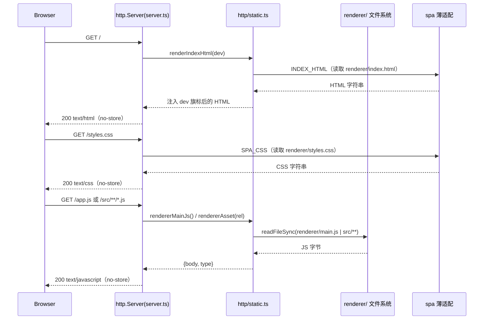

# webui SPA 拆分设计（评审 ②：SPA 出模板串）

> **状态：历史文档（2026-09-27）**  
> 本方案（`src/ui/spa/` TS 模块 + tsc 直发）已被 **`renderer/` 单源 + electron-vite** 取代。  
> **当前权威**：[`module-desktop.md`](module-desktop.md) · UI 文件：`renderer/{index.html,styles.css,main.js}`。  
> 保留本文仅作决策轨迹：模板串事故根因、为何曾冻结「不引入 Vite」、以及后续为何又迁移 electron-vite。

> 归属：F16–F23 本地 Web 控制台前端交付形态；F24 桌面壳加载同一 SPA。
> 背景：2026-09-27 架构评审发现 3（见 `.agents/memory/review-findings.md`）。
> 架构见 [`../architecture.md`](../architecture.md) §7.1；宿主模块见 [`module-webui.md`](module-webui.md)。
> 方案已与用户确认：**最小拆分 · 独立 TS 模块**（当时不引入 Vite/React，沿用 tsc）。

## 背景与问题

`src/ui/static.ts` 以 1282 行 TS 模板字面量承载整页 SPA（HTML 结构 + 全量 CSS + 全部浏览器 JS）。
2026-09-27 生产事故：源码中的 `\'` 转义被模板字面量吞噬，服务端吐出的内联脚本 SyntaxError，
整页事件绑定全部失效。结构性根因：

- 浏览器 JS 是"字符串里的语言"：tsc 不解析、不校验，转义层数靠人保证；
- 字符串断言测试（`toContain`）无法发现真实语法错误；
- §7.1 曾冻结"轻量 Vite + 原生 SPA"，但 package.json 从未引入 vite —— 冻结决策与实现漂移。

## 目标 / 非目标

**目标**

- 浏览器可执行 JS 脱离模板字面量，成为真实源码文件：tsc 校验、按原样编译下发；
- 消除"转义吞噬"类事故的结构根因；语法守卫测试对新形态继续有效；
- 零新增依赖、零构建链改动（仍 `tsc` 单步）、Electron 打包路径不变。

**非目标**

- 不引入 Vite / React / 任何前端构建器；不做组件化框架改造；
- 不改变任何 UI 行为、视觉、HTTP API 契约（页面表现与拆分前等价，仅脚本由内联变外链）；
- 不在本期解决 HTTP 加固（评审发现 4，另行设计）。

## 方案：src/ui/spa/ 真实 TS 模块

### 目标布局

```text
src/ui/spa/
├─ index.ts      # INDEX_HTML：仅文档结构 + head 内联 dev 旗标小脚本 + 外链引用
├─ styles.ts     # SPA_CSS：全量样式字符串（字符集无转义风险）
├─ app.ts        # 浏览器端全部逻辑：零 TS 语法的纯脚本（tsc 校验 + 原样下发）
└─ globals.d.ts  # Window.picbedNative / __PICBED_UI_DEV__ 环境类型（不 emit）
src/ui/static.ts # 缩为 barrel：export { INDEX_HTML } from './spa/index.js'
```

`detectUiDevMode` 的源码树标记文件（`src/ui/static.ts`）保持不变。

### 关键决策

| # | 决策 | 理由 |
|---|------|------|
| 1 | `app.ts` 写**纯脚本 JS**（无 import/export、无类型标注），DOM 类型由 tsconfig 默认 lib（target ES2022 → es2022.full 含 DOM）提供，`Window` 扩展由 `globals.d.ts` 声明合并 | src 与 dist 逐字节一致：tsc 对"将要下发的字节"做语法/类型校验；`new Function(src)` 守卫可直接作用于源文件 |
| 2 | `GET /app.js` 由 server 以 `import.meta.url` 定位**编译产物兄弟文件**（`dist/ui/spa/app.js`）fs 读取下发，`text/javascript` | 真实静态下发；Electron asar 内 `fs.readFileSync` 可读；`desktop/main.mjs` 本就经 `dist/ui/index.js` 加载，相对解析一致 |
| 3 | `GET /styles.css` 下发 `styles.ts` 编译常量（内存，零 fs） | tsc 不拷贝 .css；CSS 字符集无反引号/反斜线/`${`，字符串承载无事故史 |
| 4 | `INDEX_HTML` 外链 `<script src="/app.js" defer>` + `<link rel="stylesheet" href="/styles.css">` | `defer` 与原"body 末尾内联脚本"执行时机等价（DOM 解析完成后执行） |
| 5 | dev 旗标仍为 head 内联小脚本 + `__PICBED_UI_DEV_FLAG__` 占位替换，`renderIndexHtml` 不变 | 打包版必须可关「规范」入口（F24 调试门），注入点保留 |
| 6 | 两个静态路由置于 API 路由之前，`Cache-Control: no-store` 与现状一致 | 行为对齐现状 |

### 打包与运行

- tsconfig `include: src/**/*`：无引用也会产出 `dist/ui/spa/app.js`；
- electron-builder `files: dist/**/*` 已覆盖；npm 包 `files: [bin, dist, README.md]` 不变；
- `desktop:dev` 监听 `dist` 递归：前端改动热重载语义不变；
- 运行时前提：`picbed ui` / 桌面壳均跑编译产物（`bin` 与 `desktop/main.mjs` 本就只加载 dist）。

## 测试适配（tests/desktop.test.ts）

- 结构断言保留在 `INDEX_HTML`（`dropzone` / `navDoc` hidden / 已删面板不回潮 / 旗标占位）；
- `getPathForFile` / `picbedNative` / drop 时序（collect → 渲染 → submit）/ blob 去重断言改读 **`src/ui/spa/app.ts` 源文件**；
- 语法守卫：`new Function()` 作用于 app.ts 源码；`INDEX_HTML` 现存内联脚本（旗标）继续覆盖；
- 新增可执行守卫：`INDEX_HTML` 不得含多行内联脚本（行数阈值），防止大脚本回灌模板串。

已知验证缺口：静态路由的 200/Content-Type 行为依赖 dist 产物，单测不覆盖（dist 被 gitignore、可能陈旧）；
由 `npm run build` 后人工启动 `picbed ui` 浏览器核对兜底，连同页面等价性一起验证。

## 同步文档修正

- `docs/architecture.md` §7.1 前端行 + 开放问题 8：冻结措辞由"轻量 Vite + 原生 SPA"改为"原生 SPA 拆分为 `src/ui/spa/` 真实 TS 模块，tsc 直编、静态路由下发（不引入 React/Vite）"；
- `docs/design/module-webui.md` 头部增加本文件指针；
- `scripts/validate.mjs`（`--profile=design`）文件清单加入本文件。

## 交付物与验收

- 代码：`src/ui/spa/{index,styles,app}.ts`、`src/ui/spa/globals.d.ts`、`src/ui/static.ts` barrel、`src/ui/server.ts` 两个静态路由、`tests/desktop.test.ts` 适配；
- 文档：本文件 + 上述三处修正；
- 验收：`npm run build && npm test && npm run lint` 全绿；`picbed ui` 页面行为与拆分前一致（人工浏览器核对拖拽上传/管理/设置/主题切换）。

## 实现落点（TS/Electron 适配）

> **状态提示**：本设计为历史方案（`src/ui/spa/app.ts` 纯脚本 + tsc 直发）。当前**已废弃**，UI 单源迁移到 `renderer/` 并经 electron-vite 编译；`src/ui/spa/*` 仅保留**薄适配**（从 `renderer/` 读文件 re-export），供 `createUiServer` 兼容与测试。以下为**当前实际源码落点**（源码：`src/ui/spa/index.ts`、`src/ui/spa/styles.ts`、`src/ui/spa/globals.d.ts`、`src/ui/http/static.ts`、`src/ui/static.ts`、`src/ui/server.ts`、`renderer/`）。
> 当前权威形态见 [`module-desktop.md`](module-desktop.md)；本段仅记录"模板串事故"的终态落点，便于追溯。

### 实际文件夹结构（当前：spa 薄适配 + renderer 单源）

```text
renderer/                  # UI 单源（Vite root）—— 浏览器 JS 现由此编译下发
├─ index.html
├─ styles.css
├─ main.js                # 浏览器 ESM 入口（原 spa/app.ts 的角色迁移至此）
└─ src/**                 # 渲染器 ESM 模块（浏览器按相对路径回源）
src/ui/
├─ spa/
│  ├─ index.ts            # INDEX_HTML：fs 读取 renderer/index.html（薄适配）
│  ├─ styles.ts           # SPA_CSS：fs 读取 renderer/styles.css（薄适配）
│  └─ globals.d.ts        # Window.picbedNative / __PICBED_UI_DEV__ 类型声明（不 emit）
├─ static.ts              # barrel → spa/index
├─ server.ts              # 静态路由：GET / 与 /index.html、/styles.css、/src/**、/app.js 与 /main.js（先于 API 路由）
└─ http/
   └─ static.ts           # detectUiDevMode / renderIndexHtml / rendererMainJs / rendererAsset
```

### 领域层类图（SPA 下发装配）

```mermaid
classDiagram
    class SpaIndexAdapter {
        <<module: src/ui/spa/index.ts>>
        +INDEX_HTML: string  // 读取 renderer/index.html
    }
    class SpaStylesAdapter {
        <<module: src/ui/spa/styles.ts>>
        +SPA_CSS: string  // 读取 renderer/styles.css
    }
    class StaticDelivery {
        <<module: src/ui/http/static.ts>>
        +detectUiDevMode(explicit?) boolean
        +renderIndexHtml(dev) string
        +rendererMainJs() string|null
        +rendererAsset(rel) {body, type}|null
    }
    class UiServer {
        <<module: src/ui/server.ts>>
        +静态路由 GET / 与 /index.html , /styles.css , /src/** , /app.js 与 /main.js
    }
    class RendererFiles {
        <<external: renderer/>>
        +index.html
        +styles.css
        +main.js
        +src/** (ESM 浏览器模块)
    }
    SpaIndexAdapter ..> RendererFiles : read index.html
    SpaStylesAdapter ..> RendererFiles : read styles.css
    StaticDelivery ..> RendererFiles : read main.js / src/**
    UiServer ..> StaticDelivery : 静态下发
    StaticDelivery ..> SpaIndexAdapter : INDEX_HTML
    StaticDelivery ..> SpaStylesAdapter : SPA_CSS
```

### 公开服务签名（TS）

| 服务 | 签名 | 职责 |
|------|------|------|
| `INDEX_HTML` | `export const INDEX_HTML: string`（`src/ui/spa/index.ts`） | 读取 `renderer/index.html` 作为单源，替代原内联模板串（消除转义吞噬根因） |
| `SPA_CSS` | `export const SPA_CSS: string`（`src/ui/spa/styles.ts`） | 读取 `renderer/styles.css` |
| `detectUiDevMode` | `detectUiDevMode(explicit?: boolean): boolean` | dev 旗标解析优先级：① `explicit` 实参（为 boolean 时直接返回）→ ② `PICBED_UI_DEV=1/0` → ③ 源码树判定（包根存在 `src/ui/static.ts`） |
| `renderIndexHtml` | `renderIndexHtml(dev: boolean): string` | 注入 `__PICBED_UI_DEV__` 后的 index.html |
| `rendererMainJs` | `rendererMainJs(): string \| null` | 读取 `renderer/main.js`（浏览器 ESM 入口，每次重读，桌面刷新即生效） |
| `rendererAsset` | `rendererAsset(rel: string): {body: Buffer; type: string} \| null` | 白名单后缀（`.js/.mjs/.css/.json/.svg`）+ 防 `..` 逃逸，下发 `renderer/src/**`（与 Vite dev `/src/**` 同形） |

> **废弃项**：原方案决策 1 的 `src/ui/spa/app.ts`（无 import/export 的纯脚本、tsc 校验 + `new Function` 守卫）已被 `renderer/main.js`（electron-vite 编译）取代；原 `GET /app.js` 现由 `rendererMainJs()` 提供，浏览器 JS 不再以"字符串里的语言"承载。

### 复杂任务时序图（静态资源下发）



> 静态路由位于 API 路由之前，`Cache-Control: no-store` 与现状一致（决策 6）。`rendererAsset` 仅放行 `src/` 树内白名单后缀并禁止 `..`，防止目录逃逸（同 [`module-webui-http-hardening.md`](module-webui-http-hardening.md) 的安全基调）。
